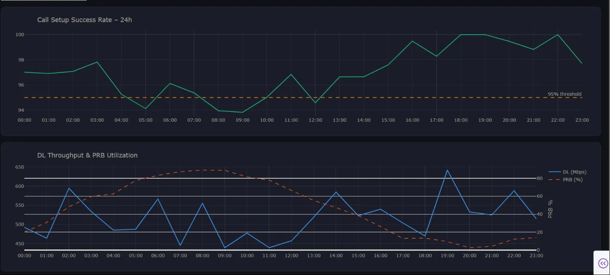
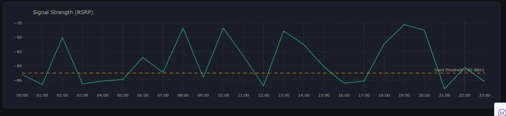
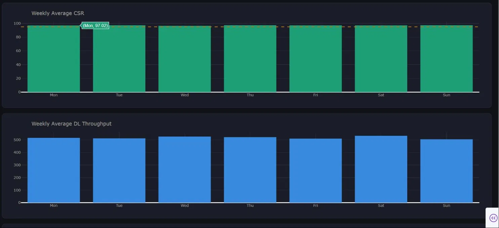
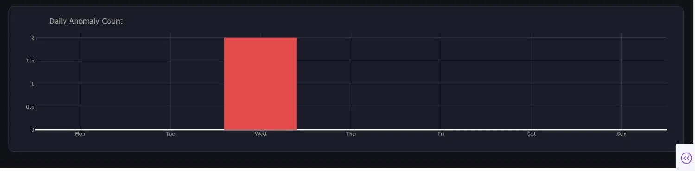
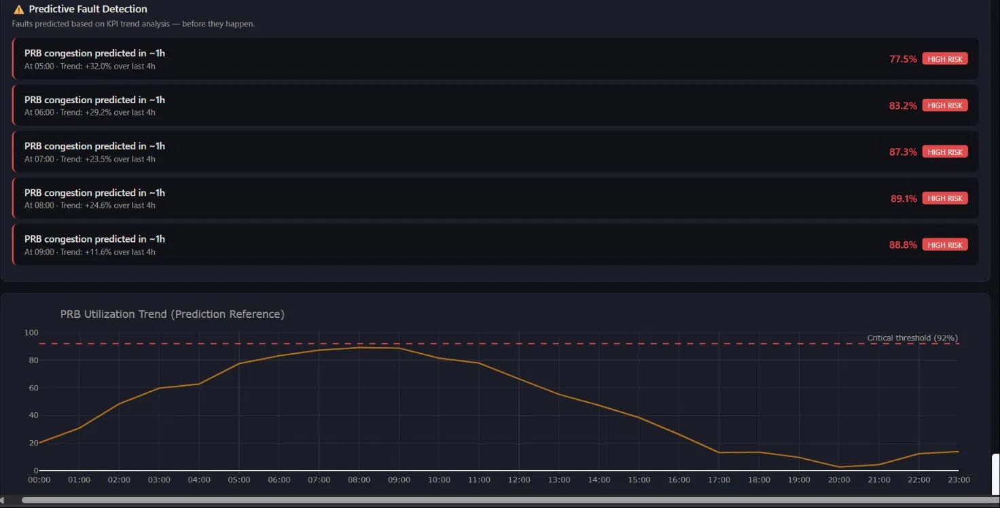
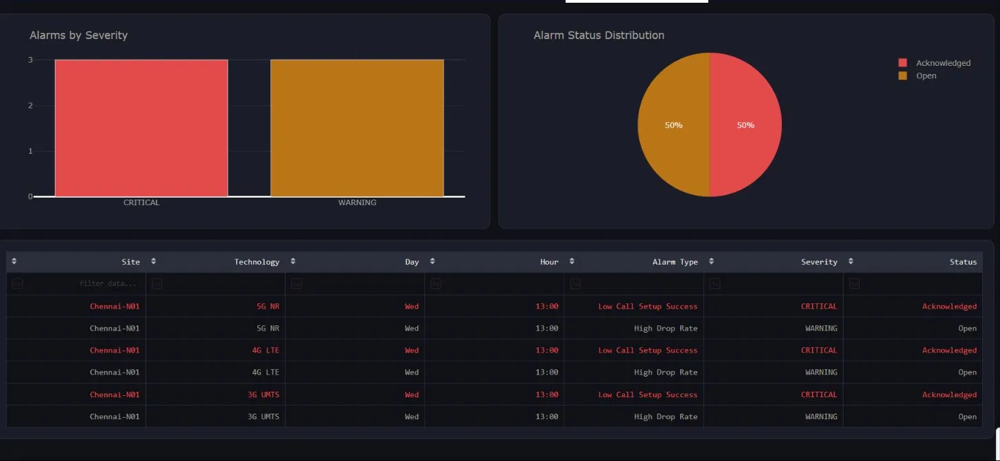
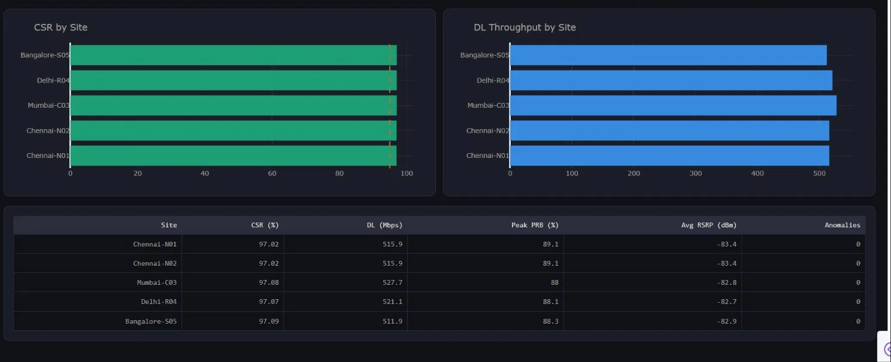
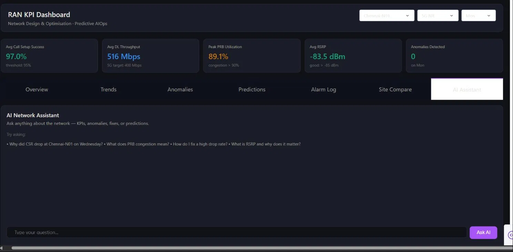

# RAN KPI Dashboard

**Radio Access Network performance monitoring · Anomaly analysis · Network optimisation**

An interactive telecom portfolio project built with **Python, Dash and Plotly**. Explore simulated network performance across five sites, compare technologies, investigate KPI degradation and review early warning indicators in one dashboard.



[Features](#features) · [Screenshots](#screenshots) · [Run locally](#run-locally) · [Demo walkthrough](#demo-walkthrough)

## Project at a glance

| Area | Coverage |
| --- | --- |
| Technologies | 3G UMTS, 4G LTE and 5G NR |
| Sites | Chennai-N01, Chennai-N02, Mumbai-C03, Delhi-R04 and Bangalore-S05 |
| Dataset | Seven simulated days, with 24 hourly samples per site and technology |
| Analysis | KPI trends, threshold-based anomalies and rule-based fault indicators |
| Interface | Seven dashboard tabs with site, technology and day selectors |
| Optional integration | Claude-powered assistant using the selected dashboard context |

The dashboard demonstrates a workflow relevant to **RAN performance analysis, network operations and network optimisation**: inspect KPIs, identify degradation, compare sites and investigate possible causes.

## Features

| Dashboard tab | What it shows |
| --- | --- |
| **Overview** | Hourly call setup success, downlink throughput, PRB utilisation and signal strength, alongside summary cards. |
| **Trends** | Weekly averages for call setup success and throughput, plus daily anomaly counts. |
| **Anomalies** | Low call setup success, high drop rate and PRB congestion alerts with severity labels and suggested investigation steps. |
| **Predictions** | Rule-based warnings from recent PRB and call setup success trends. |
| **Alarm Log** | A sortable, filterable alarm table with severity charts and simulated status distributions. |
| **Site Compare** | Side-by-side site metrics and comparison charts for the selected technology and day. |
| **AI Assistant** | Questions about KPIs and potential causes, with selected site metrics, anomalies and predictions supplied as context. |

## KPI reference

These are the demonstration values and rules implemented in the application, rather than universal operator targets.

| Metric | Display or detection rule |
| --- | --- |
| Call Setup Success Rate (CSR) | Summary reference: 95%. Anomaly: more than 6 percentage points below the selected day's mean. |
| Downlink throughput | Displayed targets: 400 Mbps for 5G, 100 Mbps for 4G and 6 Mbps for 3G. |
| PRB utilisation | Summary congestion indicator above 90%; anomaly detection above 92%. |
| RSRP | Summary “good” indicator above −85 dBm. |
| Drop rate | Anomaly when above both 2% and 2.5 times the selected day's mean. |

## Screenshots

The overview appears above. Expand the gallery to browse the additional project captures.

<details>
<summary><strong>View the full screenshot gallery</strong></summary>

### Dashboard capture 2


### Dashboard capture 3


### Dashboard capture 4


### Dashboard capture 5


### Dashboard capture 6


### Dashboard capture 7


### Dashboard capture 8


</details>

## Technology stack

| Tool | Role |
| --- | --- |
| **Python** | Data generation, analysis rules and application logic |
| **Dash** | Interactive interface, filters and callbacks |
| **Plotly** | Time-series charts and site comparisons |
| **Pandas** | KPI tables, aggregation and analysis |
| **Anthropic SDK** | Optional AI assistant integration |

## Run locally

1. **Install Python** on your computer.
2. **Download the project:** on GitHub, click **Code → Download ZIP**, then extract it.
3. **Open a terminal** in the extracted folder containing `app.py`.
4. **Install the required packages:**

   ```bash
   python -m pip install dash plotly pandas anthropic
   ```

5. **Start the dashboard:**

   ```bash
   python app.py
   ```

6. **Open your browser** and go to **http://127.0.0.1:8050**.

The dashboard works without an API key; only the **AI Assistant** needs an `ANTHROPIC_API_KEY`.

**Simple explanation:** “I install the required Python packages, run `app.py` to start the local server, and open the dashboard in my browser.”

## Demo walkthrough

1. Select a **site**, **technology** and **day** to inspect the summary cards and hourly charts.
2. Choose **Chennai-N01 → Wednesday** to investigate an injected degradation at **13:00**.
3. Choose **Mumbai-C03 → Friday** to investigate another injected degradation at **20:00**.
4. Open **Anomalies** to review detected issues and suggested checks.
5. Use **Trends**, **Predictions** and **Site Compare** to explore the broader performance pattern.
6. Review the **Alarm Log**, or ask the optional AI assistant about the selected network state.

## Repository guide

| File | Purpose |
| --- | --- |
| [app.py](app.py) | Dashboard layout, synthetic dataset, detection rules, charts and AI callback |
| [README.md](README.md) | Project overview and setup guide |
| [preview.webp](preview.webp) | Main dashboard preview |
| `ss1.webp`–`ss8.webp` | Original project screenshots; `ss1.webp` duplicates the preview |

## Project scope

This is a **simulation and learning project**. Data is generated locally when the application starts; it is not connected to a live operator network. Fault indicators use hand-written trend rules rather than a trained prediction model. Alarm statuses are randomly assigned for demonstration, and the simulated technologies share a simplified KPI schema.

## Author

**Mohammed Suhail K**  
[GitHub profile](https://github.com/mohammedsuhail007)
